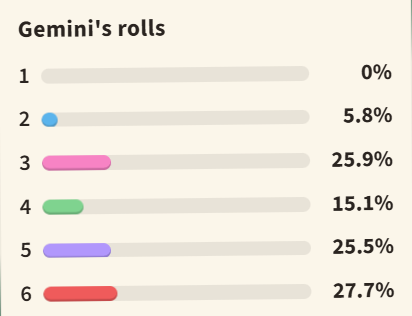

## Gemini's die
We opened 1,000 separate chats with Gemini 2.5 Flash and typed the same request each time: "Roll a die for me. Just tell me the number." The chart shows how often it gave each number.

Based on these rolls, what is the chance Gemini's roll is a **5 or a 6**?

---
### **Answer:** 0.532

---

**Explanantion:**

**Solution**

One roll cannot be a 5 and a 6 at once, so the two events are mutually exclusive, and the chance of either is the sum of their chances:

P(5 or 6) = 0.255 + 0.277 = 0.532

A fair die gives 2 / 6 ≈ 0.333. Gemini rolls a 5 or a 6 more than half the time, and in 1,000 rolls it never once said 1.