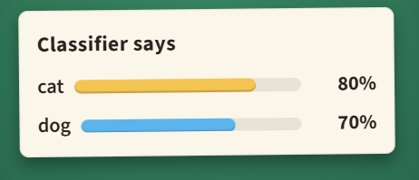

## Cat or dog?

An image classifier looks at a photo and reports 80% cat and 70% dog. Is the classifier broken?

A. Yes: probabilities can never add up to more than 1 \
B. Not if a photo can show both a cat and a dog \
C. Not if the photo is blurry

#### **Answer:** Not if a photo can show both a cat and a dog

---

**Exaplanation**

**The idea**

Probabilities only have to fit together for events that cannot both happen.

**Solution**

It depends on what the events are. If every photo shows exactly one animal, "cat" and "dog" cannot both be true, so their chances can add up to at most 1, and 1.5 is broken. But if a photo can show both, the events overlap, and 80% cat with 70% dog is fine: the photo probably shows both.

