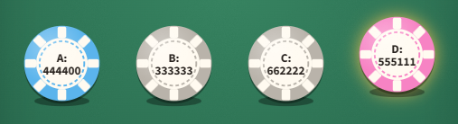

## A leaderboard with no winner
A leaderboard with no winner

Four dice play head to head. Die A has faces 4, 4, 4, 4, 0, 0. Die D has faces 5, 5, 5, 1, 1, 1. Roll both once. What is the chance that D beats A (shows the higher number)?

#### Efron's dice: the six faces of each die

### **Answer:** 0.667

----
**Explanation**

**The idea**
Head-to-head wins don't have to line up into a ranking. AI leaderboards built from pairwise matches can hit the same cycles.

**Solution**
Of the 36 equally likely pairs, D wins in two kinds:
* D shows a 5 (3faces): it beats every face of A, so 3 x 6 = 18 pairs.
* D shpws a 1 (3 faces): it beats only A's two 0s, so 3 x 2 = 6 pairs.

That is 18 + 6 / 36 = 2/3. The twist: A beats B, B beats C, and C beats D, each with chance 2/3 too. There is no best die.