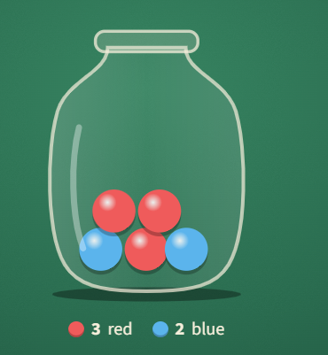

## Pick a marble

A jar holds 3 red marbles and 2 blue marbles. You reach in without looking and pull one out. What is the chance it is **blue**?

### **Answer:** 0.4

---

**Explanation**

**The idea**
With equally likely outcomes, probability is counting.

**Solution**
Each of the 5 marbles is equally likely, and 2 are blue: 
2/5 = 0.4.

