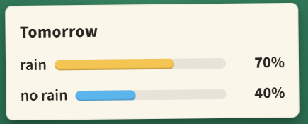

## A suspicious forecast

A weather app says tomorrow has a 70% chance of rain and a 40% chance of no rain. Is something wrong?

A. No: rain and no rain are separate events \
B. Yes: rain and no rain must add up to 100 \
C. No: it might only drizzle

#### **Answer:** Option B: Yes: rain and no rain must add up to 100%

---

**Explanation**

**The idea**
An event and its opposite always add up to 1.

**Solution**
Yes. "Rain" and "no rain" cannot both happen, and one of them must. So their chances must add up to exactly 1, and 
0.7 + 0.4 = 1.1.

