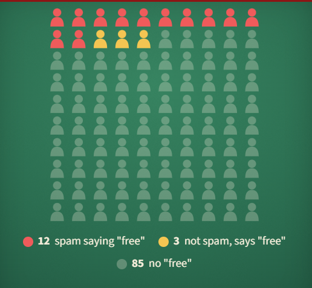

## Spam that says "free"

Out of 100 emails, 40 are spam. The word "free" appears in **12** of the spam emails and in **3** of the others.

An email says "free". What is the chance it is spam?

#### **Answer:** 0.8

---

**Explanation**

**The idea**
Condition by keeping only the cases you know happened.

**Solution**
Fifteen emails say "free", and 12 pf them are spam, so P (spam | free) = 12/15 = 0.8.
