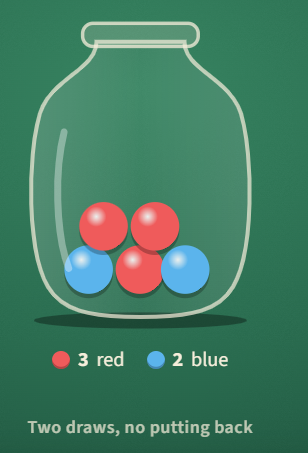

## Two reds in a row

A jar holds 3 red and 2 blue marbles. You draw one marble, keep it, and draw another. What is the chance both are red?

#### **Answer:** 0.3

---

**Explanation**

**The idea**
Each draw changes the jar for the next one.

**Solution**
The first marble is red with probability 3/5. Then the jar holds 2 red and 2 blue, so the second is red with probability 2/4. Both happen with probability 
3/5 × 2/4 = 0.3.