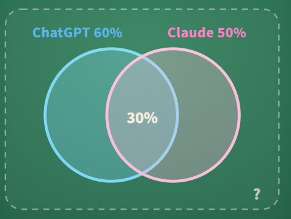

## ChatGPT or Claude

In a class, **60%** of students use ChatGPT, **50%** use Claude, and **30%** use both. What fraction use **at least one** of them?

#### **Answer:** 0.8

---

**Explanation**

**The idea**
For "or", add the two and subtract the overlap you counted twice.

**Solution**
Adding 0.6 + 0.5 counts the students who use both twice, so substract them once: 0.6 + 0.5 - 0.3 = 0.8.
