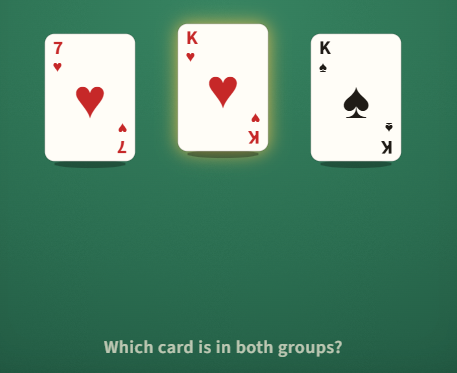

## A heart or a king

You draw one card from a shuffled standard deck of 52. What is the chance it is a **heart or a king** (or both)?

#### **Answer:** 0.3077

---

**Explanation**

**The idea**
Do not count the overlap twice.

**Solution**
There are 13 hearts and 4 kings, but the king of hearts is in both groups, so there are 13 + 4 - 1 = 16 cards that count. The chance is 16/52 = 4/13 ≈ 0.308.

