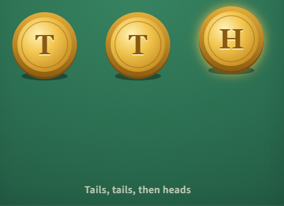

## Third time lucky

You flip a fair coin until it lands heads. What is the chance the **first** head comes on the **third** flip?

#### **Answer:** 0.125

---

**Explanation**

**The idea**
A specific sequence of independent events: multiply along it.

**Solution**
The first two flips must be tails and the third heads. The flips are independent, so the chance is 
1/2 x 1/2 x 1/2 = 1/8.
