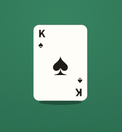

## The Mystery Card

You randomly pick one card from a standard fair deck of 52 playing cards. What is the probability that you pick a red card or a king?

A. 15/26 \
B. 7/13 \
C. 1/4 \
D. 7/15

#### **Answer:** Option B: 7/13

---

**Explanation**

**The idea**
Use the addition rule for overlapping events.

**Solution**
There are 26 red cards and 4 kings in a deck of 52 cards. Since 2 kings are red, subtract them once to avoid counting them twice. The probability is (26+4−2) / 52 = 28/52 = 7/13.

