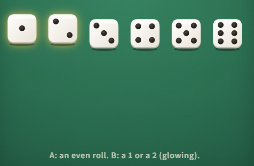

## Hidden independence

Roll a fair die. Let A be "the roll is even" and B be "the roll is a 1 or a 2". Are A and B independent?

A. Yes \
B. No: they share the outcome 2 \
C. No: one roll cannot give two independent events

#### **Answer:** Option B: 7/13

---

**Explanation**
The idea
Independence is about the numbers, not about whether events share outcomes.

**Solution**
Yes. P(A) = 1/2 and P(B) = 1/3. Both happen only on a 2, so 
P(A and B) = 1/6, which is exactly 1/2 × 1/3. Knowing the roll is a 1 or 2 leaves the chance of even at  1/2.

