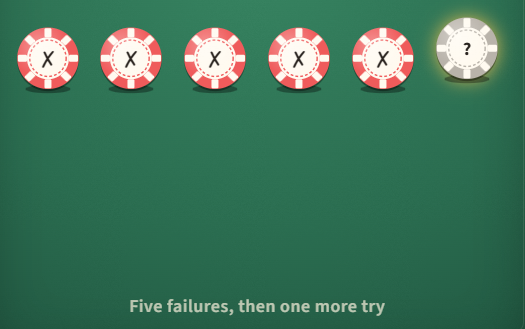

## The sixth try

You do not know how good an AI model is at a particular coding problem. It has failed the problem five times in a row. Is its sixth try less likely to work than its first was?

A. No: the tries are independent, so nothing has changed \
B. Yes: five failures are evidence the problem is hard for it \
C. No: it is due for a success

#### **Answer:** Option B: Yes: five failures are evidence the problem is hard for it

---

**Explanation**

**The idea**
Repeated outcomes teach you about a chance you did not know.

**Solution**
Yes. If you knew the model's exact success rate on this problem, each try would be independent, like a coin. But you do not: five failures are evidence that the problem is hard for this model, so your best estimate of its success rate, and of the sixth try working, goes down.

Compare the coin with five heads in a row, whose chance you knew exactly.

