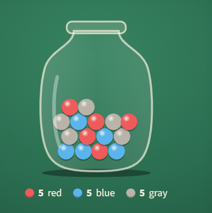

## Pairs of marbles?

A jar contains 5 red, 5 blue, and 5 gray marbles. Two marbles are selected randomly without replacement. What is the probability that they have the same color?

A. 1/2 \
B. 4/9 \
C. 2/7

#### **Answer:** Option C: 2/7

---

**Explanation**

**The idea**
There are three ways you can get marbles of the same color so you have to account for all three. Also think about what is the denominator.

**Solution**
P(same color) = P(both red)+ P(both blue) + P(both green) (there are three way)

= (5/15 x 4/14) + (5/15 x 4/14) + (5/15 x 4/14) = 2/7