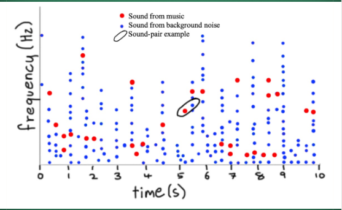

## Shazam in a noisy bar

Shazam is a phone app that listens to music and tells you which song is playing. Here it is listening in a noisy bar. In the picture, red dots are notes from the song and blue dots are noise.

Say **1 in 10** notes comes from the song, and the rest are noise from the bar, independently for each note. Shazam can't tell which notes are from the song, so it pairs up notes blindly. A pair is useful only if **both** of its notes come from the song. Shazam checks **200** pairs. What is the chance that at least one pair is useful?

#### **Answer:** 0.866

---

**Explanation**

**The idea**
A pair needs both notes, so noise hurts twice; many independent pairs win it back.

**Solution**
A pair is useful only if both notes come from the song. The notes are independent, so a pair is useful with chance 0.1 x 0.1 = 0.01

Treating the pairs as independent too (true when no two pairs share a note), all 200 pairs fail with chance 
$0.99^{200}$ ≈ 0.13, and at least one is useful the rest of the time:

1 − $0.99^{200}$ ≈ 0.87

Noise cuts each pair's chance to 1 in 100, yet 200 pairs find the song 87% of the time. A real recording gives Shazam thousands of pairs, so it nearly always finds the song.