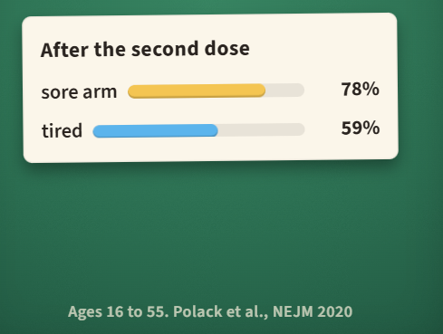

## Side effects

In the trial of the Pfizer COVID-19 vaccine, among people aged 16 to 55, **78%** had a sore arm after the second dose and **59%** felt tired.

Suppose the two side effects happen independently. What fraction of people had **at least one** of them?

#### **Answer:** 0.91

---

**Explanation**

**The idea**
For "or", subtract the overlap; for independent events, the overlap is the product.

**Solution**
Adding 0.78 + 0.59 = 1.37 counts the people with both side effects twice, so first find that overlap. Independent means multiply:

P (both) = 0.78 x 0.59 ≈ 0.46

Then subtract it once:

P (at least one) = 0.78 + 0.59 − 0.46 ≈ 0.91

About 9 in 10 people had at least one of the two, even though neither side effect alone was that common.