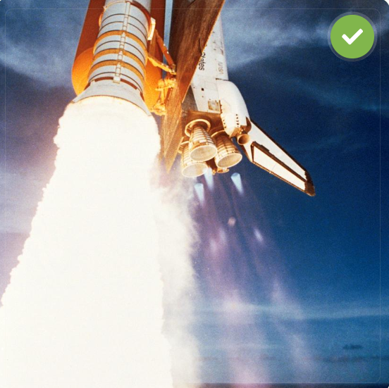

## Feynman's shuttle

"For a successful technology, reality must take precedence over public relations, for nature cannot be fooled." Richard Feynman, 1986

After the Challenger disaster in 1986, the physicist Richard Feynman asked how likely a space shuttle was to be lost on a single flight. The working engineers said about **1 in 100**. NASA management said **1 in 100,000**.

Suppose the engineers were right, and each flight succeeds or fails independently of the others. What is the chance of losing at least one shuttle in **100 flights**?

A. About 1% \
B. About 37% \
C. About 63% \
D. About 99%

#### **Answer:** Option C: About 63% 

---

**Explanation**

**The idea**
A small risk, taken many times independently, adds up fast.

**Solution**
Each flight succeeds with chance 0.99. The flights are independent, so all 100 succeed with chance 
$0.99^{100}$ ≈ 0.366. At least one is lost the rest of the time:

1 − $0.99^{100}$ ≈ 0.634

Under management's 1 in 100,000, the same calculation gives about 0.001. The shuttle flew 135 missions and two were lost, Challenger and Columbia, much closer to the engineers. That is what Feynman meant: nature cannot be fooled.

*Photo: Challenger lifts off on mission 51-F, July 1985 (NASA).*
