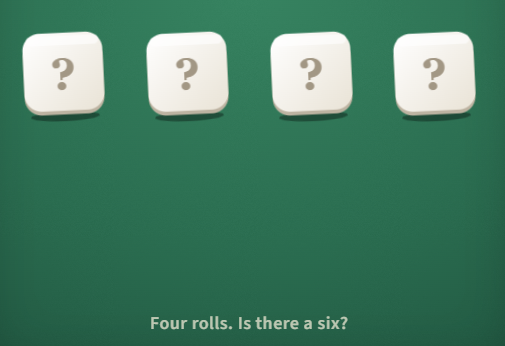

## The gambler's bet

In 1650s Paris, a gambler made steady money betting that he could roll **at least one six in four rolls** of a fair die.

What is the chance he wins the bet?

#### **Answer:** 0.518 

---

**Explanation**

**The idea**
"At least one" is one minus "none".

**Solution**
The chance of no six on one roll is 5/6. The rolls are independent, so the chance of no six in four rolls is 
$(5/6)^4$ ≈ 0.482. He wins in every other case:

1 − $(5/6)^4$ ≈ 0.518.

Just over half. A small edge, but over many bets it pays.

