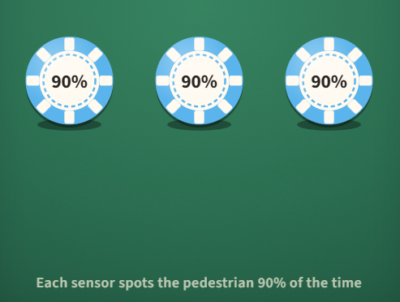

## Three sensors

A self-driving car has **3 sensors.** Each one spots a pedestrian 90% of the time, independently of the others. What is the chance that **all three** miss?

#### **Answer:**  0.001

---

**Explanation**

**The idea**
Independent backups multiply their failure rates.

**Solution**
Each sensor misses with probability 0.1, and the misses are independent, so all three miss with probability $0.1^3$ = 0.001: one in a thousand.

Notice the diminishing returns: the second sensor cut the miss rate from 10% to 1%, but the third only from 1% to 0.1%.