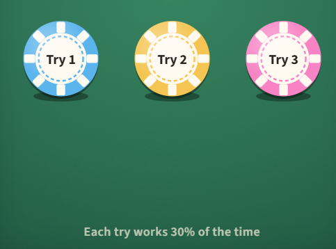

## Three tries

An AI model solves a coding problem **30%** of the time, and each try is independent. If you let it try **3 times**, what is the chance at least one try works?

#### **Answer:**  0.657

---

**Explanation**

**The idea**
More tries help a lot, which is why many AI systems sample several answers.

**Solution**
Each try fails with probability 0.7, so all three fail with probability $0.7^3$ = 0.343. At least one works the rest of the time:

1 - $0.7^3$ = 0.657.