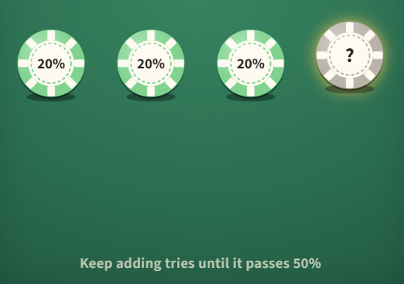

## How many tries?

Each try of an AI model works **20%** of the time, independently. What is the **smallest number of** tries that would give a probability that "at least one try works" **greater than 0.5**?

#### **Answer:**  4 tries

---

**Explanation**

**The idea**
Every extra try shrinks the chance of total failure by the same factor.

**Solution**

With k tries, at least one works with probability 1 - $0.8^k$. Three tries give 1 - 0.512 = 0.4888, just short. Four give 1 - 0.4096 = 0.59. So **4 tries**. 
