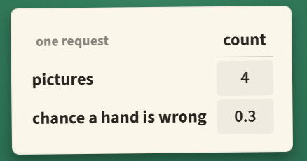

## Extra fingers

AI image generators used to be famous for drawing hands with the wrong number of fingers.

Suppose an image generator draws the hand wrong with chance **0.3** in each picture, independently of the other pictures. You ask it for **4** pictures of a person waving. What is the chance that at least one picture has a correct hand? Give your answer to three decimal places.

#### **Answer:**  0.992

---

**Explanation**

**The idea**
Ask for several tries, and "at least one works" climbs fast.

**Solution**
All 4 pictures have a wrong hand with chance $0.3^4$ = 0.0081, since the pictures are independent. So at least one is correct with chance

$1 - 0.3^4 ≈ 0.992$

That is one reason these tools show you several pictures at once: even when each one often fails, you almost always get a good one.