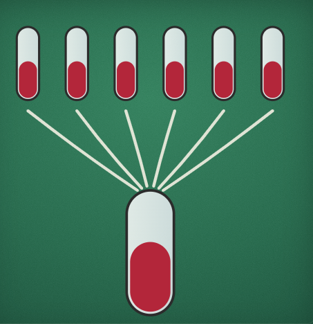

## Pool the blood

In 1943, the economist Robert Dorfman suggested a way to test US Army recruits for a disease using fewer tests: mix blood from several people and test the mix once. If the mix tests negative, everyone in it is cleared with a single test.

A lab pools blood from **6** people. Each person has the disease with chance **5%**, independently of the others, and the test is always right. What is the chance the pooled test comes back negative, clearing all six at once? Give your answer to three decimal places.

#### **Answer:**  0.735

---

**Explanation**

**The idea**
When a disease is rare, one pooled test usually clears everyone.

**Solution**
The pooled test is negative only if all six people are healthy. Each is healthy with chance 0.95, independently, so

$0.95^6 ≈ 0.735$

About three times in four, one test does the work of six. When the pool is positive, the lab tests each person on their own. Labs used the same idea in 2020 to stretch scarce COVID-19 tests.