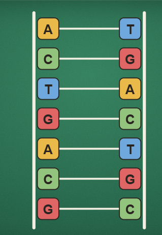

## Data stored in DNA

Scientists have stored books and pictures in DNA, which is written in four letters: A, C, G and T. A small file is stored as a string of **10,000** DNA letters.

When the file is read back, suppose each letter comes back garbled with chance **1 in a million**, independently of the other letters. What is the chance the whole file comes back perfect, with no garbled letters? Give your answer to three decimal places.

#### **Answer:**  0.99

---

**Explanation**

**The idea**
Many tiny independent risks: the chance of none is close to  $e^{−average}$.

**Solution**
Each letter comes back right with chance 0.999999, and the letters are independent, so all 10,000 are right with chance

$0.999999 ^{10,000} ≈ 0.990$

On average a read garbles $10,000$ x $1/1,000,000 - 0.01$ letters. With many letters, each with a tiny chance, the number of garbled letters is close to a Poisson with average 0.01, and the chance of zero is $e^{−0.01} ≈
0.990$: the same answer. Real DNA storage adds extra letters that let it fix the few errors, the way a QR code still scans when it is scratched