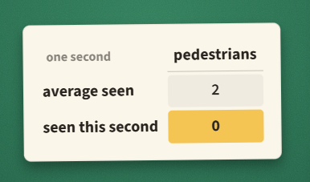

## Pedestrians in view

A self-driving car's camera counts the pedestrians it sees in each second of video. On one city street it sees **2** pedestrians per second on average. People come and go independently, so the count in one second is a Poisson random variable with an average of 2.

What is the chance the camera sees no pedestrians at all in a given second? Give your answer to three decimal places.

#### **Answer:**  0.135

---

**Explanation**

**The idea**
For a Poisson count, the chance of zero is 
$e^{−λ}$.

**Solution**
With λ=2 and k=0:

$P(X=0)=\frac{2^0 e^{-2}}{0!}=e^{-2}\approx 0.135$

So even on a street that averages 2 pedestrians a second, about 1 second in 7 has nobody in view. The car cannot treat an empty second as a promise that the street stays empty.