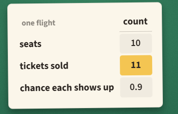

## Overbooked

Airlines often sell more tickets than a plane has seats, because some passengers don't show up.

A small plane has **10** seats, and the airline sells **11** tickets. Each passenger shows up with chance **0.9**, independently of the others. What is the chance that everyone who shows up gets a seat? Give your answer to three decimal places.

#### **Answer:**  0.686

---

**Explanation**

**The idea**
"Everyone fits" can fail in only one way here, so find that one way and subtract.

**Solution**

Someone is left without a seat only if all 11 passengers show up, which has chance $0.9^{11} ≈
0.314$. Everyone gets a seat the rest of the time:

$1 - 0.9^{11} ≈ 0.686$

So about 3 flights in 10 leave someone at the gate. That is why airlines ask for volunteers to take a later flight.