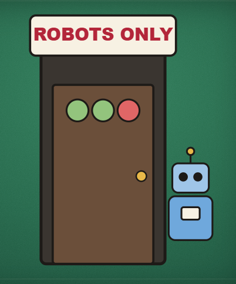

## Robots only club

A new website is just for AI agents. To keep people out, its door gives every visitor **3** quick tests that are easy for an AI and hard for a person. A visitor gets in by passing at least **2** of the 3 tests.

A person passes each test with chance **0.3**, independently of the other tests. What is the chance a person sneaks in? Give your answer to three decimal places.

#### **Answer:**  0.216

---

**Explanation**

**The idea**
"At least 2 of 3" is a binomial: add the chance of exactly 2 and exactly 3.

**Solution**

The number of tests a person passes is a binomial: 3 tests, each passed with chance 
0.3.

All $3:0.3^3 = 0.027$. Exactly 2: there are 3 ways to choose which test they fail, so $3$ x $0.3^2$ x $0.7$ $- 0.189$.

A person sneaks in with chance 
$0.027 + 0.189 = 0.216$, about 1 time in 5. An AI that passes each test with chance $0.99$ gets in $99.97%$ of the time.

