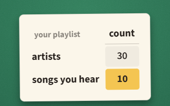

## Shuffle isn't broken

In 2014, Spotify's engineers wrote that people complained their shuffle wasn't random: songs by the same artist kept playing close together.

Say your playlist has songs by **30** artists, the same number of songs from each. A truly random shuffle makes each song you hear equally likely to be by any of the 30 artists, independently of the other songs. You listen to **10** songs. What is the chance that at least two of them are by the same artist? Give your answer to three decimal places.

#### **Answer:**  0.815

---

**Explanation** 

**The idea**
Repeats are common in true randomness: "at least two the same" is one minus "all different".

**Solution**

All 10 songs are by different artists with chance

$\frac{30}{30}\times\frac{29}{30}\times\frac{28}{30}\times\cdots\times\frac{21}{30}\approx 0.185$

so at least two share an artist with chance 
$1−0.185≈0.815$.

A truly random shuffle repeats an artist most of the time, so it feels broken. Spotify's engineers changed their shuffle to spread each artist's songs out: they made it less random so it would feel more random.