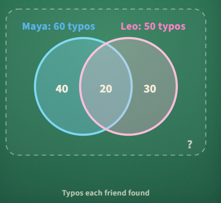

## Two proofreaders

An author asks two friends to proofread her new book, each on their own. Maya finds **60** typos. Leo finds **50**. When they compare lists, **20** typos were found by both of them.

Suppose Maya has the same chance of catching every typo, and so does Leo, and they catch typos independently of each other. About how many typos does the book have in total, including the ones neither of them found?

#### **Answer:**  150 typos

---

**Explanation** 

**The idea**
The overlap between two independent searches tells you how much both missed.

**Solution**

Of Leo's 50 typos, Maya caught 20, so Maya catches about 
$\frac{20}{50}$ = 40% of typos. Because she catches typos independently of Leo, that holds for all the typos in the book.

Maya found 60 typos, so if that is 40% of them, the book has about $\frac{60}{0.4}$ =
150 typos. Together they found $40+20+30=90$, so about 60 typos are still hiding.

Ecologists use the same trick to count fish in a lake: catch some, tag them, release them, then see how many tagged fish turn up in a second catch.