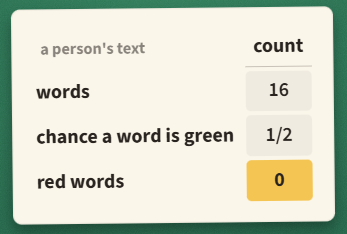

## Sixteen words, no red

Some AI companies hide a watermark in what their AI writes. Before it writes, the words it knows are split at random into two halves, a green half and a red half, and the AI uses only green words.

A person who doesn't know the split picks a green word half the time, independently for each word. A person writes a **16-word text**. What is the chance it has no red words at all? Answer as "1 in N": what is N?

#### **Answer:**  65536 N

---

**Explanation** 

**The idea**
Independent ANDs shrink fast: every word halves the chance.

**Solution**

Each word is green with chance markdown 1/2, independently, so all 16 are green with chance 
$\left(\frac{1}{2}\right)^{16}=\frac{1}{65,536}$. So N = $65,536$.

A person almost never writes 16 words with no red ones, so a text like that is strong evidence it came from the watermarked AI. This idea is from Kirchenbauer et al., ICML 2023.