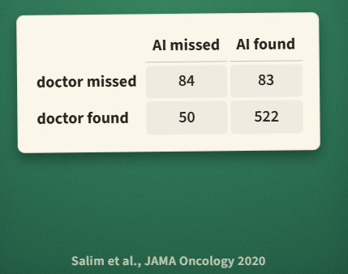

## The hardest cancers

Stockholm, 739 cancers found by screening. An AI missed **134** of them. A doctor missed **167**, and **84** of those were also missed by the AI. Of the cancers the doctor missed, what fraction did the AI also miss? Give your answer to three decimal places.

#### **Answer:**  0.503

---

**Explanation** 

**The idea**
Two readers that miss the same hard cases help each other less than independence promises.

**Solution**

$P(\text{AI misses}\mid\text{doctor missed})=\frac{84}{167}\approx 0.503$. Over all cancers the AI misses only $\frac{134}{739} ≈
0.18$. Knowing the doctor missed makes an AI miss almost three times as likely: the misses are not independent.