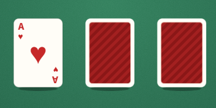

## The Three Cards

You have three face-down cards. Two hearts and one diamond. You shuffle the cards and flip one over. It's a heart! Without putting it back, you flip a second card. What is the probability that the second card is also a heart? Give your answer to three decimal places.

#### **Answer:**  0.5

---

**Explanation** 

**The idea**
Knowing the first card was a heart changes the probabilities for the second draw.

**Solution**

At the start there are two hearts and one diamond. The first card was a heart and stays out, so one heart and one diamond remain. The second card is a heart with chance $\frac{1}{2} = 0.5$.
