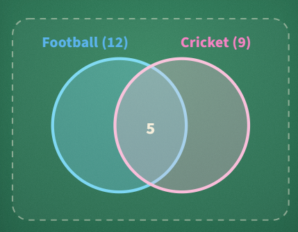

## The Double Club Member

In a group of 20 students, 12 play football, 9 play cricket, and 5 play both. A student is chosen randomly. What is the probability that they play football or cricket? Give your answer to three decimal places.

#### **Answer:**  0.8

---

**Explanation**

**The idea**
When events overlap, subtract the intersection once.

Solution
The number playing at least one sport is $12+9−5=16$. Hence, the probability is $\frac{16}{20}=0.8$.