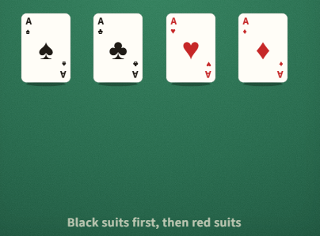

## Colored sequence of cards?

You shuffle a standard 52-card deck. What is the chance it ends up as one black suit in order from ace to king, then the other black suit from ace to king, then one red suit from ace to king, then the other red suit from ace to king? Either black suit may come first, and either red suit may come first.

A. 2/52! \
B. 4/52! \
C. 1/26!

#### **Answer:**  OptionB: 4/52!

---

**Explanation**

**The idea**
Count the orders that fit, and give each one chance $\frac{1}{52!}$.

**Solution**
Either black suit can come first (2 ways), and either red suit can come first (2 ways), so 4 decks fit the description. Each of the 52! orders is equally likely, so the chance is $\frac{4}{52!}$.