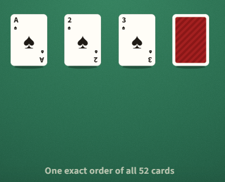

## Exact sequence of cards?

You shuffle a standard 52-card deck. What is the chance it ends up in exactly this order: spades from ace to king, then clubs from ace to king, then hearts from ace to king, then diamonds from ace to king?

A. 1/52! \
B. 1/26! \
C. It's never going to happen

#### **Answer:**  OptionA: 1/52!

---

**Explanation**

**The idea**
Chain rule: multiply the chance of each next card, given the cards before it.

**Solution**

The first card must be the ace of spades: chance $\frac{1}{52}$. Given that, the second must be the 2 of spades: chance $\frac{1}{51}$. Keep going down to the last card, and multiply:

$\frac{1}{52}\times\frac{1}{51}\times\cdots\times\frac{1}{1}=\frac{1}{52!}$

$52!$ is a 68-digit number, so a well-shuffled deck is almost certainly in an order no deck has ever been in before.