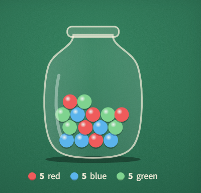

## Pairs of marbles with at least one red?

A jar contains 5 red, 5 blue, and 5 green marbles. Two marbles are selected randomly without replacement. What is the probability that at least one will be red?

A. 4/7 \
B. 3/7 \
C. 2/5

#### **Answer:**  OptionA: 4/7

---

**Explanation**

**The idea**
At least one red = 1 − no reds

**Solution**

There are 10 non-red marbles out of 15. If the first is non-red, 9 non-red marbles remain out of $14$. $1-(10/15*9/14)=4/7$