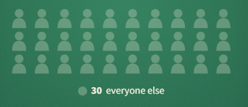

## The Birthday Party Plot Twist

There are 30 people at a party. What is the chance that at least two of them share a birthday? Ignore leap years and assume every day is equally likely.

A. 10% \
B. 30% \
C. 71% \
D. 50%

#### **Answer:**  OptionC: 71%

---

**Explanation**

**The idea**
At least two the same is one minus all different.

**Solution**

Thirty people make **435 different pairs**, and each pair has a small chance of matching. Those small chances add up fast. It is easier to find the chance that **nobody** matches, about 29%, and subtract that from 1. So the answer is about 71%.