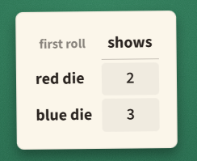

## Don't roll it again, Sam

Sam rolls a red die and a blue die and gets a red 2 and a blue 3. He rolls both dice again. What is the chance he does **not** get a red 2 and a blue 3 again? Give your answer to three decimal places.

#### **Answer:**  0.972

---

**Explanation**

**The idea**
When one outcome is easy to count, find it and subtract from 1.

**Solution**

It is easier to find the chance he repeats. The red die shows 2 again with chance $\frac{1}{6}$, and the blue die shows 3 again with chance $\frac{1}{6}$, independently, so a repeat has chance $\frac{1}{36}$. Not repeating: $1-\frac{1}{36}≈
0.972$.