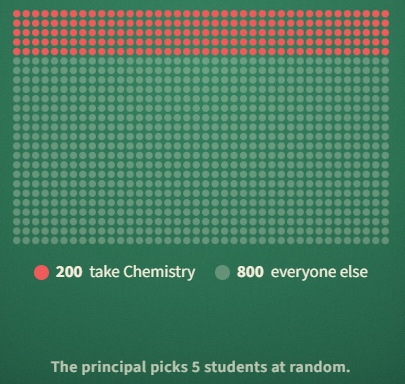

## The Chemistry Catalyst

A high school has 1,000 students, and **20%** of them take Chemistry. The principal picks 5 students at random for a new science council.

The school is large, so treat the 5 picks as independent, each taking Chemistry with chance 0.2. What is the chance that **at least one** of the 5 takes Chemistry?

A. 79.52% \
B. 67.2% \
C. 86.6%

#### **Answer:**  OptionB: 67.2%

---

**Explanation**

**The idea**
"At least one" is one minus "none".

**Solution**

It is easier to find the chance that none of the 5 take Chemistry: each one doesn't with chance 0.8, independently, so none do with chance $0.8^5 ≈
0.328$. So at least one does with chance $1−0.328=0.672$, $67.2\%$.

