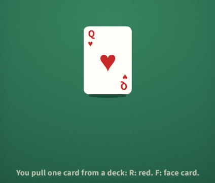

## Independence revisited

From a standard deck of cards with 26 red, 26 black, 4 suits and 3 face cards (Jack, Queen, King) per suit, you pull one card. Event R is a red card. Event F is a face card of any suit. Are the two events independent?

A. No, one card cannot give two independent events \
B. Yes \
C. No, the probability of R is larger than F

#### **Answer:**  OptionB: Yes

---

**Explanation**

**The idea**
If we restrict to event R (red only, half the deck), we still have the same probability for F

**Solution**

Yes. P(R) = 1/2 and P(F) = 12/52. P(R and F) = 6/52. This is the same as P(R)*P(F). Looking at it another way: There are 6 red face-cards within the reds: P(F|R) = 6/26. This is the same as P(F) = 12/52 = 6/26.