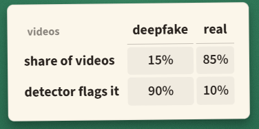

## Deepfake or real?

A fact-checking team runs an AI detector on videos shared online. Of the videos, **15%** are AI-generated deepfakes. The detector flags **90%** of deepfakes, and it also wrongly flags **10%** of real videos.

A video gets flagged. What is the chance it really is a deepfake? Give your answer to three decimal places.

#### **Answer:**  0.614 

---

**Explanation**

**The idea**
A flag means less than the detector's accuracy suggests when the thing it looks for is rare.

**Solution**

A flagged deepfake happens with chance $0.15×0.90=0.135$, and a flagged real video with chance $0.85×0.10=0.085$. So

$P(\text{deepfake}\mid\text{flagged})=\frac{0.135}{0.135+0.085}\approx 0.614$

Even with a detector that is right 90% of the time, about 4 flags in 10 land on real videos, because real videos far outnumber deepfakes.