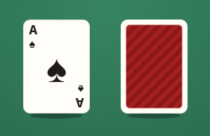

## The Ace of Spades

You shuffle a standard deck of 52 cards and deal two cards face-down to a friend. Your friend looks at one of them and tells you it is the **Ace of Spades**.

What is the chance that both cards are aces?

A. 1/221 \
B. 1/17 \
C. 1/33 \
D. 1/13

#### **Answer:**  OptionB: 1/17

---

**Explanation**

**The idea**
Once the Ace of Spades is known, only the other card is unknown: 3 aces among the 51 cards left.

**Solution**

One card is known: the Ace of Spades. The other card is equally likely to be any of the other 51 cards, and 3 of those are aces. So the chance is $\frac{3}{51} = \frac{1}{17}$. 
