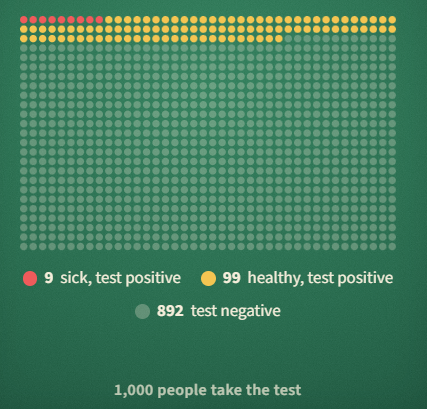

## The positive test

A disease affects **1 in 100** people. A test catches **90%** of people who have it, but it also comes back positive for **10%** of people who do not.

You test positive. What is the chance you have the disease? Give your answer to three decimal places.

#### **Answer:**  0.0833

---

**Explanation**

**The idea**
A rare cause stays fairly rare, even after a good test says yes.

**Solution**

Of 1,000 people, 10 are sick and 9 of them test positive. Of the 990 who are healthy, 10% (99 people) test positive too. So of the 108 positive tests, only 9 come from sick people:

$P(sick∣positive)= \frac{9}{108}≈0.083$.

About 1 in 12. The disease is so rare that false alarms outnumber real cases.