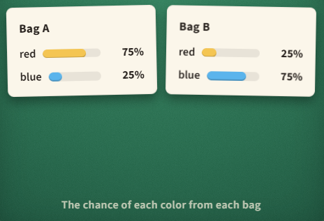

## Which bag?

Bag A holds 3 red marbles and 1 blue. Bag B holds 1 red and 3 blue. You flip a fair coin to pick a bag, then draw one marble: it is **red**.

What is the chance you picked **bag A**? Give your answer to three decimal places.

#### **Answer:** 0.75

---

**Explanation**

**The idea**
Evidence favors the explanation that makes it more likely.

**Solution**

Bag A and red happens with probability $\frac{1}{2}\times\frac{3}{4}=\frac{3}{8}$; bag B and red with $\frac{1}{2}\times\frac{1}{4}=\frac{1}{8}$. Of all the ways to see red, bag A accounts for

$\frac{\frac{3}{8}}{\frac{3}{8}+\frac{1}{8}}=\frac{3}{4}$. 