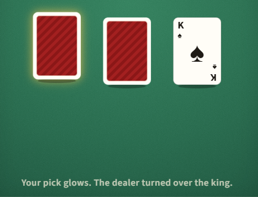

## Find the ace

Three cards lie face down. One is the ace of hearts. You point at one card.

The dealer, who knows where the ace is, always turns over one of the **other two** cards that is not the ace. Then you may switch to the last face-down card. Should you?

A. Switch: it wins 2 times out of 3 \
B. Stay: it wins 2 times out of 3 \
C. It does not matter: each card is a 1/2 chance

#### **Answer:** OptionA: Switch: it wins 2 times out of 3 

---

**Explanation**

**The idea**
What the dealer shows you depends on where the ace is, and that is information. 

**Solution**

Switch. Your first pick is the ace with probability $\frac{1}{3}$, and the dealer's move cannot change that. With probability $\frac{2}{3}$ the ace is one of the other two cards, and the dealer has just shown you which one it is not. So switching wins $\frac{2}{3}$ of the time.

This is the Monty Hall problem. It has fooled a great many people, professional mathematicians included.

