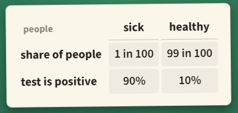

## Positive, twice

A disease affects **1 in 100 **people. A test catches 90% of sick people and wrongly flags 10% of healthy ones. You test positive, then take a second, independent test, and it is **positive too**.

What is the chance you have the disease now? Give your answer to three decimal places.

#### **Answer:** 0.45

---

**Explanation**

**The idea**
Each piece of independent evidence updates your belief again.

**Solution**

Out of 10,000 people, 100 are sick, and $100×0.81=81$ of them test positive twice. Of the 9,900 healthy people, $9,900×0.01=99$ test positive twice. So

$P(\text{sick}\mid\text{two positives})=\frac{0.0081}{0.0081+0.0099}=0.45$

One positive test left the chance near 8%. A second one lifts it to 45%.