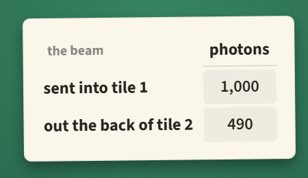

## Through two tiles

An X-ray beam fires **1,000** photons through two identical tiles, one behind the other. A photon gets through each tile with the same unknown chance θ, independently, so it gets through both with chance θ × θ.

The detector behind the tiles counts **490** photons. Which θ makes this count most likely? Give your answer to three decimal places.

#### **Answer:**  0.7

---

**Explanation**

**The idea**
Find the best chance for what you can count, then work back to the parameter.

**Solution**
A photon gets through both tiles with chance 
$θ^2$, so the count is like 1,000 coin flips that land heads with chance $θ^2$. The best guess for that chance is the fraction that made it: 490/100 = 0.49.

So $θ^2$ = 0.49 and θ = 0.7: each tile lets 70% of photons through. The tiles being identical is what makes this work. With two different tiles, one beam could not tell them apart: every pair with $θ_1 x θ_2 = 0.49$ would fit the count equally well, the ridge from the Maximum Likelihood lesson.
