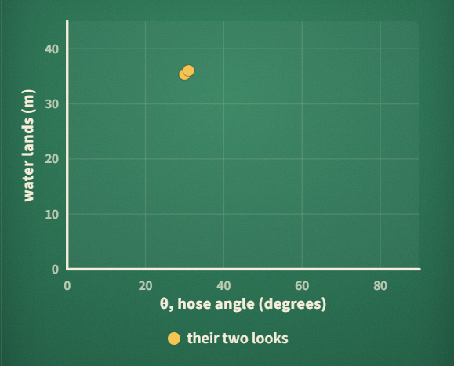

## Two looks at a fire hose

A firefighter wants the hose angle that sends the water farthest. Their parameter is θ, the angle of the hose in degrees, and the score is how far away the water lands. They cannot see the whole curve of score against angle: each look means spraying at one angle and measuring where the water lands.

They start at θ = 30°, where the water lands **35.35 m** away. To measure the slope, they look once more at a nudge, θ = 31°, which gives **36.04 m**. The nudge is only a look, so the step starts from 30°. With a step size of **5**, what is their new θ? Give your answer to three decimal places.

#### **Answer:** 33.45 °

---

**Explanation**

**The idea**
Two looks give a slope, and the slope says which way is uphill and how far to step.

**Solution**

The slope is  $∂_score/∂θ ≈ (36.04−35.35)÷1 = 0.69$ meters per degree. It is positive, so uphill is toward bigger angles:

$$
new θ=30+5×0.69=33.45°
$$

The step starts from 30°, not 31°: the nudge was only a look to measure the slope.

These distances come from water leaving the hose at 20 m/s with no air. Its best angle is 45°, about 40.8 m, and a few more steps get there. With air pushing back on the water, the best angle is lower.