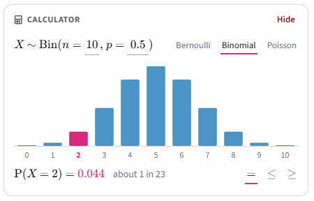
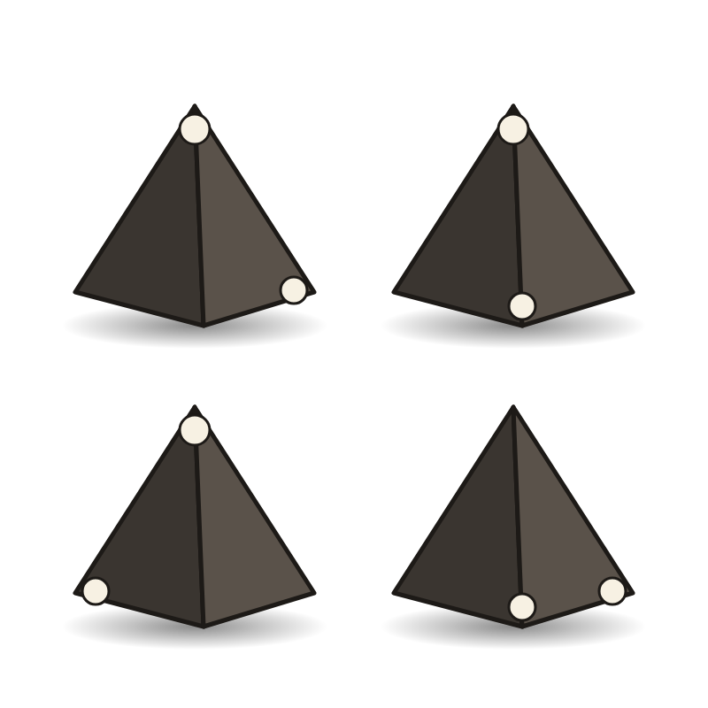

## The Royal Game of Ur

The Royal Game of Ur is a board game from ancient Mesopotamia, about 4,500 years old. Its dice have four corners instead of six faces. On each die, two corners are marked with a white dot and two are plain. When you throw a die, one corner points straight up, and each of the **four** corners is equally likely to be that one.

In the rules people play today, you throw four of these dice, each landing independently, and move one space for each white dot pointing up. In the picture, 3 dots point up, so you would move 3 spaces. What is the chance you move exactly **2** spaces? Give your answer to three decimal places.

#### **Answer:** 0.375

---

**Explanation**

**The idea**
For exactly k dots out of n fair dice, count the ways to choose which k, then divide by 
$2^n$.

**Solution**
Each die shows a dot on top with chance 
2/4 = 1/2, and the dice are independent, so each of the 16 ways the four dice can land has chance $(1/2)^2 = 1/16$.

Exactly two dots point up in 6 of them: DDPP, DPDP, DPPD, PDDP, PDPD, PPDD. So the chance is 
$\frac{6}{16} = 0.375$

That 6 counts the ways to choose which 2 of the 4 dice show a dot, $\binom{4}{2}$. Moving 2 is the most likely throw: 1 and 3 each come up 4 times in 16, and 0 and 4 only once in 16.
