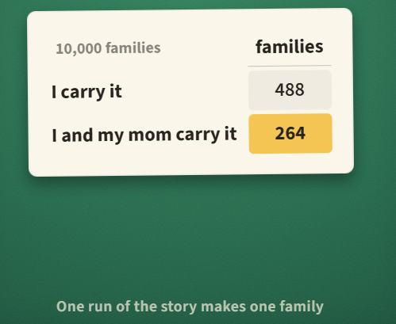

## The scary gene

Out in the world, 1 person in 20 carries a certain gene. It runs in families, so we use a story that makes a family one person at a time. The story has two knobs. Anyone whose parents are not in the story carries the gene with chance 0.05. A parent who carries it hands a copy to each child with chance 0.5.

We ran the story 10,000 times, making 10,000 families, and counted what happened. You learn that I carry the gene. Using the counts in the table, what is the chance that my mom carries it too? Give your answer to three decimal places.

#### **Answer:** 0.541

---

**Explanation**

**The idea**
To answer a question with a model, run the story many times and count the runs that match.

**Solution**
Keep only the 488 families where I carry the gene. In 264 of them my mom carries it too, so the chance is $\frac{264}{488}≈ 0.541$.

Out in the world the chance is only 0.05. Knowing I carry it changes that: my copy came from my mom or my dad, so each of them is much more likely to carry it.

Running a story many times and keeping only the runs that match what you know is called rejection sampling.